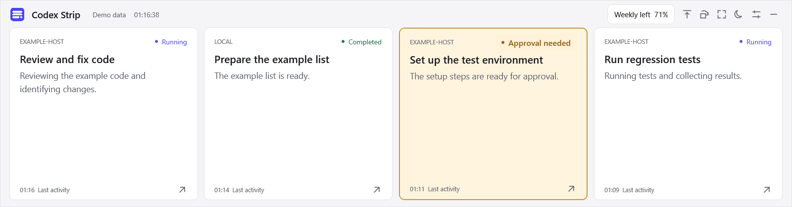
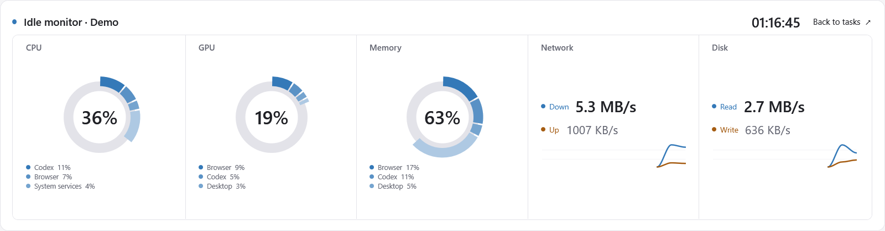

<h1 align="center"> Codex Strip</h1>

<p align="center"><a href="README.md">简体中文</a> · <strong>English</strong></p>

A task status bar for Codex on Windows, with horizontal and vertical layouts for secondary displays. Shows task progress, requests for input, and usage limits. When idle, it can switch to system resource monitoring.

[Download portable version](https://github.com/gobunu/Codex-Strip/releases/latest) · [User guide](USER_GUIDE.en.md) · [Report an issue](https://github.com/gobunu/Codex-Strip/issues)

## Screenshots

### Task board

<picture>
  <source media="(prefers-color-scheme: dark)" srcset="screenshots/tasks-dark-en.png">
  <source media="(prefers-color-scheme: light)" srcset="screenshots/tasks-light-en.png">
  
</picture>

Displays each task's host, status, latest message, and remaining weekly usage. Completion indicators follow Codex's read state.

### Resource monitor

<picture>
  <source media="(prefers-color-scheme: dark)" srcset="screenshots/resources-dark-en.png">
  <source media="(prefers-color-scheme: light)" srcset="screenshots/resources-en.png">
  
</picture>

Shows CPU, GPU, and memory usage, plus network and disk speeds. When no tasks are running or awaiting input, it can open automatically after a configurable delay. New tasks, questions, or unread results bring the task board back.

## Features

| Feature | Details |
| :--- | :--- |
| Tasks | Progress, requests for input, and unread results for local, cloud, and SSH tasks |
| Navigation | Click to open a conversation; temporary child threads open their main thread when a parent link is available |
| Usage limits | Remaining weekly usage and limit details |
| Resource monitor | CPU, GPU, and memory usage, usage by major processes, and network and disk speed charts |
| Layout | Horizontal or vertical, docking to any screen edge, floating window, fullscreen, and system tray |
| Display settings | 100%–200% scaling, with position and scale saved separately for each monitor |
| Appearance | Light and dark themes, custom wallpapers, clear glass and edge refraction effects |

## Quick start

**Requirements:** Windows, .NET Framework 4.8, and a running Codex desktop app.

1. Download `CodexStrip-portable-en.zip` from the [latest release](https://github.com/gobunu/Codex-Strip/releases/latest) and extract it. The Chinese build is available as `CodexStrip-portable-zh-CN.zip`.
2. Open the Codex desktop app, then run `CodexStrip.exe`. Keep `CodexStrip.exe.config` in the same folder.
3. Choose your monitor, dock position, number of visible tasks, and interface scale in Settings.

> To update, exit Strip before replacing the application files. Keep the entire `data/` folder.

### Controls

| Action | Result |
| :--- | :--- |
| Click / right-click a task card | Open the conversation / preview its messages |
| Click **Weekly left** | View usage limit details |
| `F11` / `Esc` | Toggle fullscreen / exit fullscreen and restore the previous position |
| Click the idle resource view | Return to the task board |
| Click the top bar's minimize button | Minimize to the system tray |

## Development and build

Run in Windows PowerShell:

```powershell
./source/build.ps1 -Language en
./CodexStrip.exe --self-test
./CodexStrip.exe --settings-test
./source/package.ps1 -Language all
```

| Script | Language options |
| :--- | :--- |
| `build.ps1 -Language` | `zh-CN` (default) or `en` |
| `package.ps1 -Language` | `zh-CN`, `en`, or `all` (default; creates both packages) |

`source/tests/` contains development checks for reading the desktop API, conversation navigation, temporary-to-main thread links, settings, layout, idle behavior, and resource display. Some tests interact with windows or temporarily reserve part of the screen's work area.

## Files

| Path | Contents |
| :--- | :--- |
| `source/` | C# source, build scripts, and development checks |
| `assets/`, `screenshots/` | Icons and example screenshots |
| [USER_GUIDE.en.md](USER_GUIDE.en.md) | Detailed features, configuration, and controls |
| [RELEASE_NOTES.md](RELEASE_NOTES.md) | Version changes |
