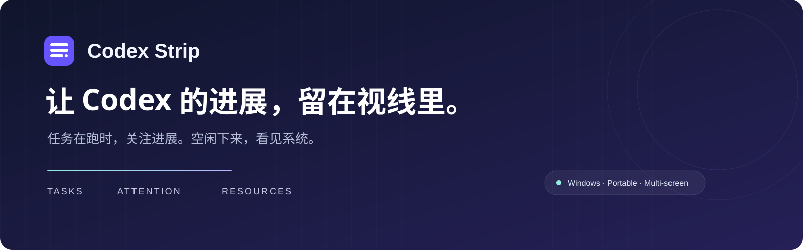

<div align="center">

<p></p>

**Windows 上的 Codex 任务状态条，为副屏与多任务工作准备。**

任务进展、待办提醒、剩余额度，一眼可见。空闲时，自动切换到系统资源监控。

<a href="https://github.com/gobunu/Codex-Strip/releases/latest"><strong>下载便携版</strong></a> · <a href="#快速开始">快速开始</a> · <a href="#功能一览">功能一览</a> · <a href="使用说明.md">使用说明</a> · <a href="https://github.com/gobunu/Codex-Strip/issues">反馈问题</a>

<sub>Windows · .NET Framework 4.8 · 免安装 · 横向 / 竖向副屏</sub>

</div>

---

## 任务在跑，进展在眼前

把状态条放到副屏或屏幕边缘，让主要工作区留给代码。正在运行、等待回答、需要确认和未读结果，会在任务卡片中直接显示。

<picture>
  <source media="(prefers-color-scheme: dark)" srcset="screenshots/tasks-dark.png">
  <source media="(prefers-color-scheme: light)" srcset="screenshots/tasks-light.png">
  
</picture>

<p align="center"><sub>任务看板 · 明暗主题随系统切换 · 截图使用演示数据</sub></p>

**有事时提醒，查看后清除。** 完成提醒跟随 Codex 的已读状态；点击任务卡返回对应会话，右键查看消息预览。临时子线程按已知父线程关联跳到主线程，保留云端或 SSH 主机信息。

## 空闲时，让副屏继续有用

没有运行中的任务或待处理事项时，状态条在设定的静息时间后切换为资源页面。新任务、提问或未读结果出现时，自动回到任务看板。

<picture>
  <source media="(prefers-color-scheme: dark)" srcset="screenshots/resources-dark.png">
  <source media="(prefers-color-scheme: light)" srcset="screenshots/resources.png">
  
</picture>

<p align="center"><sub>静息监控 · CPU / GPU / 内存 / 网络 / 磁盘 · 截图使用演示数据</sub></p>

显示项目、排列顺序、圆环或条形样式、网卡与颜色都可调整。还可以加入自己的壁纸，搭配清透玻璃或边缘折射效果；壁纸会保存为程序内的副本。

## 功能一览

| 工作时 | 空闲时 | 放到合适的位置 |
| :--- | :--- | :--- |
| 本地、云端与 SSH 任务状态 | CPU、GPU、内存及主要程序占比 | 横向 / 竖向布局 |
| 最新消息与待办提示 | 网络与磁盘的双曲线趋势 | 屏幕四边停靠或浮动窗口 |
| Codex 已读状态同步 | 可设置的静息倒计时 | 每块屏幕记忆位置与倍率 |
| 周剩余额度与详情 | 新任务与待办自动唤醒 | 100%–200% 界面倍率 |
| 点击跳转，右键预览 | 自定义壁纸与玻璃样式 | 全屏、置顶与系统托盘 |

## 快速开始

**运行条件：** Windows、.NET Framework 4.8，以及正在运行的 Codex 桌面应用。

1. 从 [最新 Release](https://github.com/gobunu/Codex-Strip/releases/latest) 下载 `CodexStrip-portable.zip` 并解压。
2. 打开 Codex 桌面应用，再运行 `CodexStrip.exe`。请保留同目录的 `CodexStrip.exe.config`。
3. 在设置中选择显示器、停靠位置、任务数量与界面倍率，放到你常看的位置。

> 更新时，先退出 Strip，再替换程序文件；保留完整的 `data/` 文件夹。本文介绍当前源码功能，已发布版本的变化见 [发布记录](https://github.com/gobunu/Codex-Strip/releases)。

### 常用操作

| 操作 | 结果 |
| :--- | :--- |
| 点击任务卡 / 右键任务卡 | 打开会话 / 预览消息 |
| 点击「周剩余」 | 查看额度详情 |
| `F11` / `Esc` | 切换全屏 / 退出并恢复原位置 |
| 点击静息页面 | 返回任务看板 |
| 顶栏收起按钮 | 收到系统托盘 |

## 常见问题

<details>
<summary><strong>需要 API Key 吗？会消耗 Codex 额度吗？</strong></summary>

不需要 API Key。Strip 读取正在运行的 Codex 桌面应用中的任务状态、消息与额度信息，用于界面展示；它不会替你发送对话或启动模型任务。

</details>

<details>
<summary><strong>为什么显示未连接，或者打不开某个任务？</strong></summary>

先确认 Codex 桌面应用正在运行，并与 Strip 使用相同的 Windows 用户权限。接入依赖 Codex 内部桌面接口，Codex 更新后可能需要安装适配后的 Strip。

临时子线程有可靠父线程关联时会跳到主线程；关联信息不可用时，需要从 Codex 侧栏打开主线程。

</details>

<details>
<summary><strong>为什么没有自动进入静息？</strong></summary>

静息计时需要保持连接，且没有进行中的任务、未读结果、等待回答或待确认事项。操作看板会重新计时；已空闲的历史线程不会仅因详情同步过期而阻止静息。也可从设置或托盘菜单手动进入。

</details>

<details>
<summary><strong>删除壁纸原图后还能显示吗？资源数值为何与任务管理器不同？</strong></summary>

选择壁纸后，程序会将其复制到 `data/wallpapers/`，之后可删除外部原图。更新时保留完整的 `data/` 即可。

采样间隔、动画和统计口径会影响资源显示。GPU 取最繁忙显卡引擎的占用，性能计数器不可用时显示「—」；详细口径见 [使用说明](使用说明.md)。

</details>

## 开发与构建

<details>
<summary><strong>从源码构建、验证与打包</strong></summary>

在 Windows PowerShell 中运行：

```powershell
./source/build.ps1
./CodexStrip.exe --self-test
./CodexStrip.exe --settings-test
./source/package.ps1
```

使用系统 .NET Framework 编译器，不依赖第三方运行库。便携包、SHA-256 校验文件与当前版本的发布说明输出到 `dist/`。推送版本标签后，GitHub Actions 从源码构建并上传 Release。

`source/tests/` 包含开发验证程序：桌面接口读取与跳转、临时线程到主线程的关联，以及设置、布局、静息与资源显示。部分测试会操作窗口或临时预留屏幕工作区。

</details>

<details>
<summary><strong>目录与设计资料</strong></summary>

| 路径 | 内容 |
| :--- | :--- |
| `source/` | C# 源码、构建脚本与验证程序 |
| `assets/`、`screenshots/` | 图标、README 视觉素材与演示截图 |
| [使用说明.md](使用说明.md) | 详细功能、配置与已知限制 |
| [RELEASE_NOTES.md](RELEASE_NOTES.md) | 版本变化 |
| [DESIGN.md](DESIGN.md) | 设计记录 |

个人设置、壁纸副本、EXE 和构建产物不纳入版本控制。设计参考资料的许可证见 [DESIGN-LICENSE.txt](DESIGN-LICENSE.txt)，它不代表整个项目的许可证；第三方声明见 [THIRD_PARTY_NOTICES.txt](THIRD_PARTY_NOTICES.txt)。

</details>

---

<p align="center"><strong>让进展可见，让工作专注。</strong><br><sub>Codex Strip 是独立的桌面辅助工具，与 OpenAI 无隶属关系。</sub></p>
