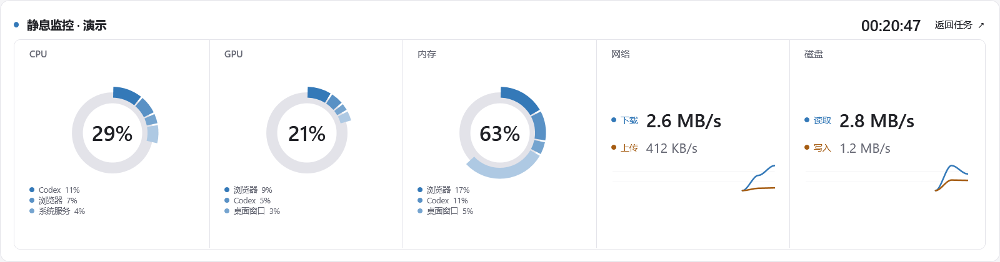

<h1 align="center"> Codex Strip</h1>

<p align="center"><strong>简体中文</strong> · <a href="README.en.md">English</a></p>

Windows 上的 Codex 任务状态条，支持横向或竖向副屏。显示任务进展、待办提示和额度，空闲时可切换为系统资源监控。

[下载便携版](https://github.com/gobunu/Codex-Strip/releases/latest) · [使用说明](使用说明.md) · [反馈问题](https://github.com/gobunu/Codex-Strip/issues)

## 界面示例

### 任务看板

<picture>
  <source media="(prefers-color-scheme: dark)" srcset="screenshots/tasks-dark.png">
  <source media="(prefers-color-scheme: light)" srcset="screenshots/tasks-light.png">
  
</picture>

显示任务主机、状态、最新消息和周剩余额度。完成提醒跟随 Codex 的已读状态。

### 资源监控

<picture>
  <source media="(prefers-color-scheme: dark)" srcset="screenshots/resources-dark.png">
  <source media="(prefers-color-scheme: light)" srcset="screenshots/resources.png">
  
</picture>

显示 CPU、GPU、内存占用及网络、磁盘速率。没有运行中的任务或待办时，可在设定时间后自动进入；新任务、提问或未读结果出现时返回任务看板。

## 功能一览

| 功能 | 说明 |
| :--- | :--- |
| 任务显示 | 本地、云端和 SSH 任务的进展、待办提示与未读结果 |
| 会话跳转 | 点击打开对应会话；临时子线程按已知父线程关联跳到主线程 |
| 额度 | 周剩余额度与详情 |
| 资源监控 | CPU、GPU、内存及主要程序占比，网络和磁盘速率曲线 |
| 布局 | 横向 / 竖向、屏幕四边停靠、浮动窗口、全屏和系统托盘 |
| 显示设置 | 100%–200% 倍率，每块屏幕独立记忆位置与倍率 |
| 外观 | 明暗主题、自定义壁纸、清透玻璃或边缘折射效果 |

## 快速开始

**运行条件：** Windows、.NET Framework 4.8，以及正在运行的 Codex 桌面应用。

1. 从 [最新 Release](https://github.com/gobunu/Codex-Strip/releases/latest) 下载中文包 `CodexStrip-portable-zh-CN.zip` 或英文包 `CodexStrip-portable-en.zip` 并解压。
2. 打开 Codex 桌面应用，再运行 `CodexStrip.exe`。请保留同目录的 `CodexStrip.exe.config`。
3. 在设置中选择显示器、停靠位置、任务数量与界面倍率。

> 更新时，先退出 Strip，再替换程序文件；保留完整的 `data/` 文件夹。

### 常用操作

| 操作 | 结果 |
| :--- | :--- |
| 点击任务卡 / 右键任务卡 | 打开会话 / 预览消息 |
| 点击「周剩余」 | 查看额度详情 |
| `F11` / `Esc` | 切换全屏 / 退出并恢复原位置 |
| 点击静息页面 | 返回任务看板 |
| 顶栏收起按钮 | 收到系统托盘 |

## 开发与构建

在 Windows PowerShell 中运行：

```powershell
./source/build.ps1 -Language zh-CN
./CodexStrip.exe --self-test
./CodexStrip.exe --settings-test
./source/package.ps1 -Language all
```

| 脚本 | 语言选项 |
| :--- | :--- |
| `build.ps1 -Language` | `zh-CN`（默认）或 `en` |
| `package.ps1 -Language` | `zh-CN`、`en` 或 `all`（默认，两种语言分别打包） |

`source/tests/` 包含开发验证程序：桌面接口读取与跳转、临时线程到主线程的关联，以及设置、布局、静息与资源显示。部分测试会操作窗口或临时预留屏幕工作区。

## 文件

| 路径 | 内容 |
| :--- | :--- |
| `source/` | C# 源码、构建脚本与验证程序 |
| `assets/`、`screenshots/` | 图标与演示截图 |
| [使用说明.md](使用说明.md) | 详细功能、配置与已知限制 |
| [RELEASE_NOTES.md](RELEASE_NOTES.md) | 版本变化 |
